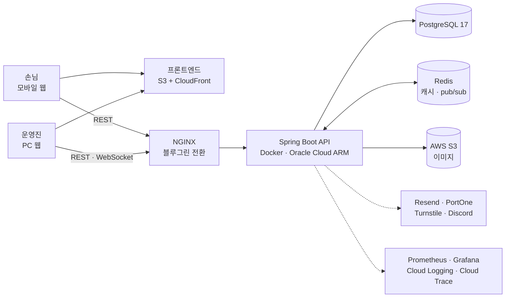

<p align="center">
  
</p>

<h1 align="center">KioSchool API</h1>

<p align="center">대학 축제 주점 QR 테이블 주문 서비스 <a href="https://kio-school.com">키오스쿨</a>의 백엔드 서버</p>

<p align="center">
  
  
  
  
  
  <br />
  
  
  
  
  
  
</p>

<p align="center">
  <a href="https://kio-school.com">서비스</a> ·
  <a href="https://github.com/KioSchool/KioSchool">프론트엔드 저장소</a>
</p>

## 키오스쿨

손님은 테이블에 붙은 QR을 찍어 휴대폰으로 주문하고, 주점 운영진은 들어오는 주문과 테이블, 매출을 실시간으로 관리한다. 대학 축제처럼 짧은 시간에 주문이 몰리는 현장에서 쓰인다.

| 누적 이용자 | 누적 주문 | 사용 주점 | 주점 누적 매출 |
|:---:|:---:|:---:|:---:|
| 36,000명+ | 30,000건+ | 179곳+ | 6억 1천만 원+ |

<sub>2026년 10월, kio-school.com 공개 수치 기준</sub>

## 기술 스택

| 구분 | 사용 |
|---|---|
| 언어·프레임워크 | Kotlin 1.9, Spring Boot 3.1, Java 17 |
| 데이터 | PostgreSQL 17, Spring Data JPA, QueryDSL, Liquibase |
| 캐시·메시징 | Redis (캐시, pub/sub) |
| 실시간 | WebSocket, STOMP, SockJS |
| 인증 | Spring Security, JWT (access token + refresh token) |
| 파일 | AWS S3, Scrimage (WebP 변환, OG 카드 생성) |
| 외부 연동 | Resend(메일), PortOne(예금주 조회), Cloudflare Turnstile(봇 차단), Discord 웹훅 |
| 관측 | Micrometer, Prometheus, Grafana, GCP Cloud Logging·Cloud Trace |
| 인프라 | Docker, NGINX, Oracle Cloud(ARM), GitHub Actions, Docker Hub |
| 테스트 | Kotest, MockK |

## 아키텍처



## 주요 구현

### 실시간 주문 전달

- 주문이 생기거나 상태가 바뀌면 도메인 이벤트를 발행하고, 트랜잭션 커밋 뒤에(`@TransactionalEventListener(AFTER_COMMIT)`) 비동기로 운영진 화면에 보낸다. 롤백된 주문이 화면에 뜨는 일이 없다
- 메시지는 Redis pub/sub을 거쳐 STOMP 구독자에게 전달된다. 블루그린 전환 중처럼 서버가 둘 떠 있어도, 클라이언트는 어느 서버에 연결돼 있든 같은 메시지를 받는다
- 구독할 때 JWT와 주점 소속을 확인해 자기 주점의 주문 채널(`/sub/order/{주점 ID}`)만 구독할 수 있다

### 캐시

- 주점, 상품, 카테고리, 주문, 통계 조회를 Redis에 캐시한다
- 변경 메서드에 커스텀 어노테이션을 붙이면 AOP가 변경 이벤트를 발행하고, 리스너가 관련 캐시만 무효화한다
- Redis에 장애가 나도 `CacheErrorHandler`가 예외를 로그로만 남기고 DB 조회로 넘어간다. 캐시 정합성보다 가용성을 우선하고, 모든 캐시에 TTL을 둬 스스로 회복되게 했다

### 인증과 보안

- JWT access token과 refresh token을 HttpOnly 쿠키로 주고받는다
- refresh token은 쓸 때마다 새로 발급(rotation)한다. 이미 쓴 토큰이 다시 들어오면 탈취로 보고 그 로그인 세션을 지운다
- `/admin/**`은 운영진, `/super-admin/**`은 슈퍼어드민으로 경로별 권한을 나누고, 운영진 API는 요청한 주점의 소속인지 확인한다
- 로그에 찍히는 이름 같은 개인정보는 `@LogMasked`로 가리고, 탈퇴한 계정은 주문 기록을 지키면서 개인정보만 익명값으로 바꾼다
- 공개 문의 폼은 Cloudflare Turnstile 검증, 이메일별 접수 횟수 제한, 보관 기간이 지난 문의 자동 삭제를 적용했다. 가입 인증 코드에는 만료 시간과 시도 횟수 제한을 뒀다

### 데이터 관리

- 스키마는 2023년부터 Liquibase changelog로 이력을 관리한다(63개)
- 기존 데이터 보정은 `V01__`부터 번호를 붙인 일회성 Kotlin 스크립트로 처리한다. 서버가 뜰 때 아직 실행되지 않은 스크립트만 순서대로 한 번 실행하고, 실행 기록을 DB에 남긴다
- 매일 아침 스케줄러가 주문 번호와 테이블 세션을 정리하고, 전날 주문으로 일별 통계와 운영진 인사이트 카드를 만든다
- 주문, 주문 상품, 테이블 세션, 상품의 변경 이력을 남긴다
- 상품·주점 사진은 업로드할 때 WebP로 줄여 S3에 저장하고, 주점 공유 링크용 미리보기 이미지(1200×630)는 서버에서 만든다

### 관측

- 로그는 JSON 구조로 GCP Cloud Logging에 모으고, 요청 일부를 Cloud Trace로 추적한다
- Micrometer 지표를 Prometheus가 수집하고 Grafana에서 본다. JVM, Tomcat 스레드, 커넥션 풀, 쿼리 지표에 더해 사용 중인 테이블 수, 운영 중인 주점 수, WebSocket 세션 수를 직접 지표로 만들었다
- 커넥션 풀이 차기 시작할 때만 경고 로그를 남기고, 오래 반납되지 않은 커넥션은 누수 감지 로그로 잡는다
- 문의 접수 같은 운영 이벤트는 Discord로 알린다

### 배포

- `main`에 push하면 GitHub Actions가 테스트를 돌린다
- 버전 태그를 push하면 jar를 빌드해 amd64·arm64 Docker 이미지를 Docker Hub에 올리고, 서버에 접속해 배포한다
- 운영 서버는 NGINX 앞단에서 블루그린 방식으로 무중단 배포하고, 배포 뒤 health check로 상태를 확인한다
- 서버의 docker compose, NGINX, 모니터링 설정은 별도 인프라 저장소에서 git으로 관리한다

## 프로젝트 구조

```
src/main/kotlin/com/kioschool/kioschoolapi/
├── domain/      order, workspace, product, user, account, email, statistics,
│                dashboard, insight, inquiry, donation, changelog
└── global/      security, websocket, cache, schedule, error, logging, monitoring,
                 aws, og, portone, discord, turnstile, toss
```

도메인마다 `controller`, `facade`, `service`, `repository`, `entity`, `dto`로 나눈다. 컨트롤러는 facade를 부르고, facade가 여러 service를 묶어 하나의 유스케이스를 처리한다.

## 라이선스

[GPL-3.0](LICENSE)
